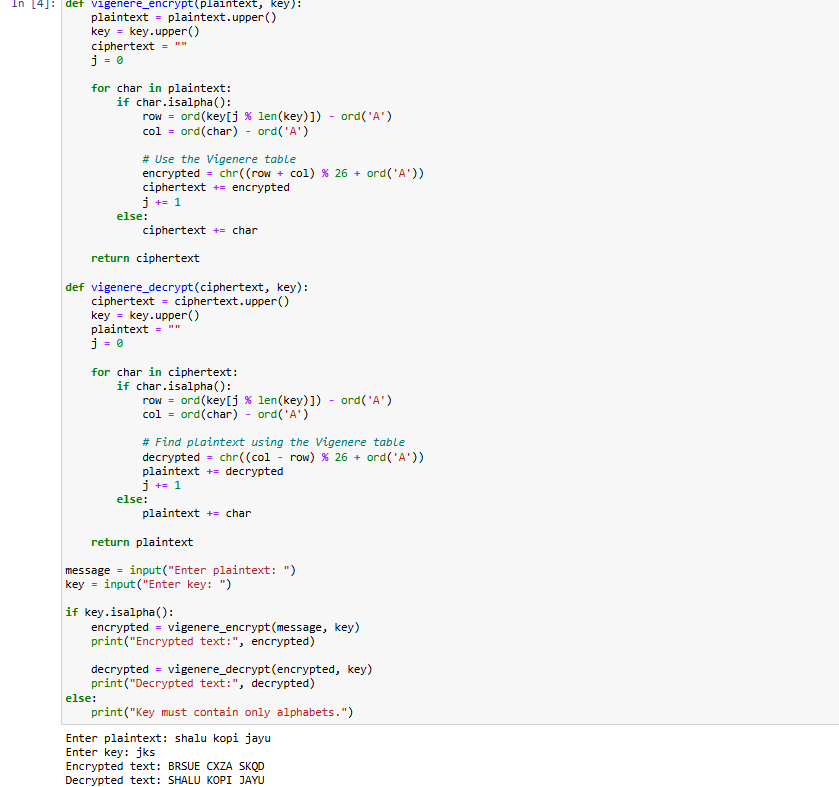

# Lab-Exercise-4---Vigenere-cipher
## Aim:
To develop a simple C program to implement Vigenere Cipher.
## Procedure:
1. Design of Vigenere Cipher algorithnm
2. Implementation using C or pyhton code
3.  The Vigenere cipher is a method of encrypting alphabetic text by using a series of different Caesar ciphers based on the letters of a keyword.
4.  It is a simple form of polyalphabetic substitution.To encrypt, a table of alphabets can be used, termed a Vigenere square, or Vigenere table.
5.  It consists of the alphabet written out 26 times in different rows, each alphabet shifted cyclically to the left compared to the previous alphabet, corresponding to the 26 possible Caesar ciphers.
6.  At different points in the encryption process, the cipher uses a different alphabet from one of the rows used. The alphabet 
at each point depends on a repeating keyword. 

## program:
```
def vigenere_encrypt(plaintext, key):
    plaintext = plaintext.upper()
    key = key.upper()
    ciphertext = ""
    j = 0
    
    for char in plaintext:
        if char.isalpha():
            row = ord(key[j % len(key)]) - ord('A')
            col = ord(char) - ord('A')
            
            # Use the Vigenere table
            encrypted = chr((row + col) % 26 + ord('A'))
            ciphertext += encrypted
            j += 1
        else:
            ciphertext += char
            
    return ciphertext

def vigenere_decrypt(ciphertext, key):
    ciphertext = ciphertext.upper()
    key = key.upper()
    plaintext = ""
    j = 0
    
    for char in ciphertext:
        if char.isalpha():
            row = ord(key[j % len(key)]) - ord('A')
            col = ord(char) - ord('A')
            
            # Find plaintext using the Vigenere table
            decrypted = chr((col - row) % 26 + ord('A'))
            plaintext += decrypted
            j += 1
        else:
            plaintext += char
            
    return plaintext

message = input("Enter plaintext: ")
key = input("Enter key: ")

if key.isalpha():
    encrypted = vigenere_encrypt(message, key)
    print("Encrypted text:", encrypted)
    
    decrypted = vigenere_decrypt(encrypted, key)
    print("Decrypted text:", decrypted)
else:
    print("Key must contain only alphabets.")
```
## Output:

## Result:
The program executed successfully.